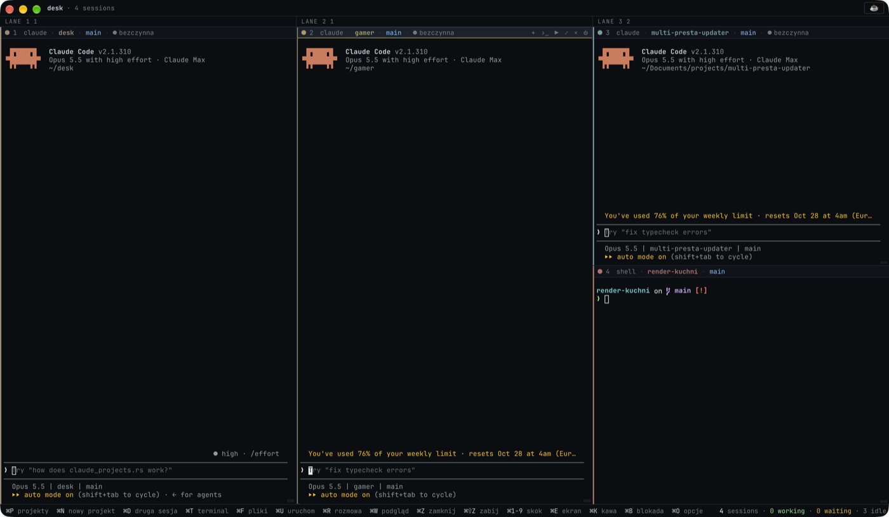
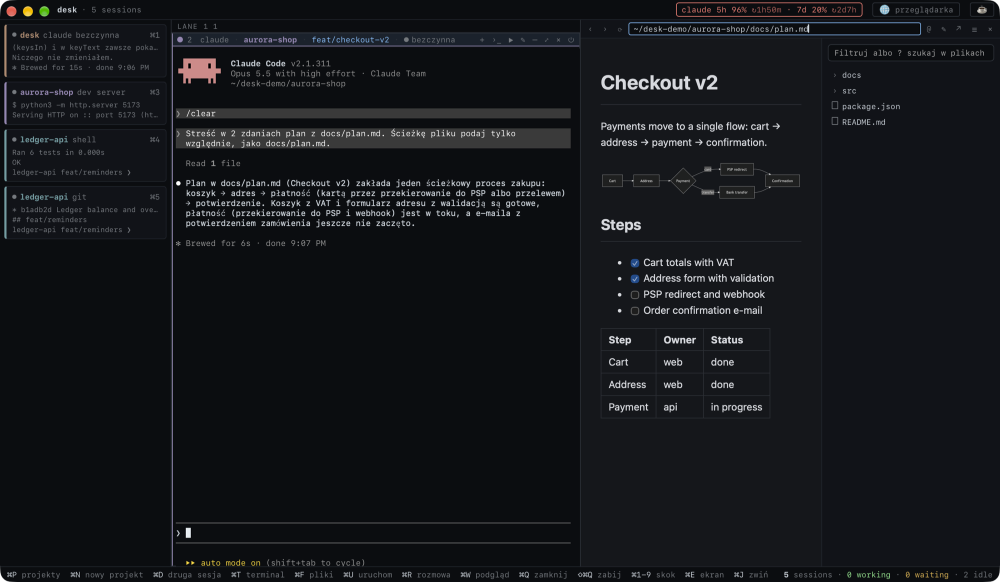
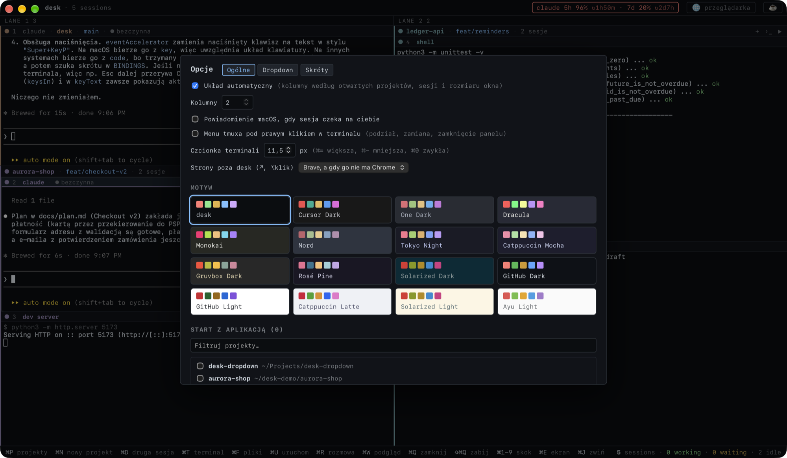
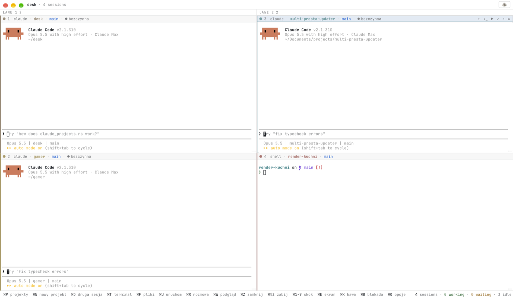

# desk

Natywna aplikacja (Tauri 2, macOS, Linux i Windows): jedno okno z siatką żywych terminali,
po jednej sesji Claude Code (albo Codex, opencode, Gemini, aider, shell) na projekt.





- **Sesje żyją w tmux** na prywatnym sockecie (`tmux -L desk`, własny `tmux.conf`), więc
  zamknięcie desk ich nie zabija. Po ponownym otwarciu kafelki wracają w tym samym układzie.
- **Stan z hooków Claude Code** (pracuje / czeka / bezczynna / shell). Hooki są doklejane przez
  `claude --settings`, więc globalna konfiguracja Claude Code i tmux zostaje nietknięta.
- **Okno nie wywołuje żadnych modeli** i nie zużywa tokenów. Limity planu czyta z plików, które
  agenci i tak zapisują lokalnie.

## Funkcje

| | |
|---|---|
| Projekty | Sam znajduje repo git i projekty z `~/.claude/projects`. Worktree są pokazane pod repo głównym, a ręcznie można dodać dowolny folder. |
| Nowy projekt | ⌘N: tworzy folder (opcjonalnie `git init`) i od razu otwiera w nim sesję. |
| Autostart | W opcjach wybierasz, które projekty startują z desk. Domyślnie żaden. |
| Agenci | Claude Code, Codex, opencode, Gemini, aider, shell, a w opcjach także własne komendy. Tab w palecie przełącza agenta. |
| Druga sesja | Kilka sesji w jednym projekcie (⌘D), w jednej ramce projektu. ⌘T dokłada do niej zwykły terminal. |
| Rozmowa | Zwykły czat o czymkolwiek, niezwiązany z żadnym projektem (⌘R). Każde ⌘R otwiera nową rozmowę we własnej ramce „rozmowa”, tak jak nowy projekt, w czystym folderze. Jej zachowanie ustawiasz w `rozmowa/CLAUDE.md` w danych desk. |
| Limity | W górnym pasku zużycie planu (5h / 7d) dla otwartych agentów: Claude z konta co 5 min i z status line sesji, Codex z `~/.codex/sessions`. Obok każdego okna czas do resetu (↻2h13m). Kolor bursztynowy od 70%, czerwony od 90%. |
| Układ | Kolumny dobierają się same do liczby projektów, sesji i rozmiaru okna (1 projekt na całe okno, 2 obok siebie, więcej w kilku kolumnach). W Opcjach można to wyłączyć i ustawić liczbę kolumn ręcznie. |
| Motywy | 16 motywów w Opcjach, ciemne i jasne: desk, Cursor Dark, One Dark, Dracula, Monokai, Nord, Tokyo Night, Catppuccin (Mocha, Latte), Gruvbox, Rosé Pine, Solarized (Dark, Light), GitHub (Dark, Light), Ayu Light. Zmieniają okno i terminale od razu. |
| Kafelek | Projekt (każdy ma swój stonowany kolor), branch git (kliknij, aby przełączyć: `git switch`, który przy niezapisanych zmianach odmawia), stan. Powiadomienie, gdy sesja czeka, a okno nie ma fokusu. |
| Pliki | ⌘F: drzewo plików aktywnego projektu w panelu obok (z `git ls-files`, bez `node_modules`), jak w Claude Desktop. Filtr po nazwie, a `?tekst` szuka w treści plików. Kliknięty plik pokazuje się w podglądzie, dwuklik otwiera go w edytorze. Folder ma kartę z akcjami: dodaj do sesji (`@ścieżka` w aktywnym Claude), terminal tutaj, pokaż w Finderze. `@` w pasku panelu dodaje do sesji pokazany plik. |
| Uruchom | ⌘U albo ▶: skrypty z `package.json` (z pnpm/yarn/npm/bun według lockfile), `cargo run`/`test`, cele z `Makefile`, `docker compose up`, Django. Uruchamia się w ramce projektu, a link `localhost` z wyjścia kliknięciem otwiera podgląd. |
| Podgląd | Panel obok terminali (⌘W): kliknięty link (strona, `localhost`, plik) otwiera się w nim, a ⌥-klik w przeglądarce. Przycisk „🌐 przeglądarka” u góry otwiera panel z paskiem adresu. Pokazuje strony i obrazki, PDF, Markdown z diagramami mermaid, pliki `.mmd`, JSON, CSV jako tabelę oraz kod i tekst. Pasek adresu działa jak przeglądarka (wstecz, odśwież, wpisany adres). Pliki z kodem i tekstem otwierają się od razu w edytorze z kolorowaniem składni (kolory z motywu). Markdown, diagramy i tabele startują jako podgląd, a ✎ przełącza je na edytor. ⌘S zapisuje, ⌘Z / ⌘⇧Z w edytorze cofa i ponawia, a „podgląd” wraca do widoku. ↗ otwiera stronę w Brave, a gdy go nie ma w Chrome (do zmiany w Opcjach, także na przeglądarkę systemową), a plik w jego domyślnym programie. Gdy panel jest otwarty, w środku zostaje aktywna sesja, a pozostałe są po lewej jako mini karty (stan i ostatnie linie). Kliknięcie albo ⌘1–9 przenosi sesję do środka. |
| Kawa | ⌘K: komputer nie zaśnie. Drugie ⌘K: także przy zamkniętej klapce. Wyłącza się sama przy przegrzaniu lub baterii ≤15%. Działa na macOS, Windows i Linuksie. |
| Blokada | ⌘B: ekran zostaje włączony, terminale widać, ale nic nie da się wpisać, dopóki nie odblokujesz: Touch ID albo hasłem na macOS, Windows Hello (PIN, odcisk palca, twarz) na Windows, hasłem konta na Linuksie. |

## Motywy





## Skróty

| Skrót | Akcja |
|---|---|
| ⌘P | projekty (paleta) |
| ⌘N | nowy projekt (folder + opcjonalnie git init) |
| ⌘D | druga sesja w tym projekcie |
| ⌘T | terminal (zwykły shell) w projekcie aktywnego kafelka |
| ⌘F | pliki projektu |
| ⌘U | uruchom (dev serwer, testy...) |
| ⌘R | rozmowa (czat bez projektu) |
| ⌘W | podgląd obok (pliki, Markdown, diagramy, strony) |
| ⌘Z | zamknij kafelek (sesja w tmux zostaje) |
| ⌘⇧Z | zabij sesję |
| ⌘1–9 | skok do kafelka |
| ⌘E / ⌘↵ | ekran pełny kafelka, ⌘Esc wraca |
| ⌘K | kawa |
| ⌘B | blokada |
| ⌘O | opcje |

W palecie: ↵ otwiera, ⌘↵ włącza lub wyłącza autostart, ⌘⌫ zabija sesję, Tab wybiera agenta.
Zwykłe Esc trafia do terminala, więc dalej przerywa Claude.

## Windows

- **Sesje działają bez tmux:** trzyma je sam desk (ConPTY), więc kończą się po zamknięciu desk.
  Zamknięcie kafelka (Ctrl⇧Z) zostawia sesję, dopóki desk jest otwarty.
- **Skróty to Ctrl+Shift+litera** zamiast ⌘ (Ctrl⇧P projekty, Ctrl⇧D druga sesja...). Zabicie
  sesji to Ctrl⇧⌫. Zwykłe Ctrl+C trafia do programu w terminalu, a kopiowanie i wklejanie to
  Ctrl⇧C / Ctrl⇧V. Tak samo jest na Linuksie.
- **Agenci działają w PowerShellu** (pwsh, jeśli jest zainstalowany) i po wyjściu z agenta
  zostaje PowerShell.
- **Hooki i status line uruchamiają sam `desk.exe`**, więc nie potrzeba sh. Limity Claude
  działają, a status line z `~/.claude/settings.json` wywołuje się przez Git Bash albo PowerShell,
  tak jak robi to Claude Code.
- **Kawa** trzyma komputer obudzonym. Tryb z klapką ustawia w planie zasilania „po zamknięciu
  pokrywy: nic nie rób” (`powercfg`, bez uprawnień administratora). Poprzednie ustawienie wraca po
  wyłączeniu kawy, a także wtedy, gdy desk się zamknie albo padnie.
- **Blokada** odblokowuje się przez Windows Hello (PIN, odcisk palca albo twarz). Bez
  skonfigurowanego Windows Hello ustaw PIN w Ustawienia → Konta → Opcje logowania.

## Wymagania

- macOS, Linux (webkit2gtk 4.1) albo Windows 10/11 (WebView2)
- macOS i Linux: `tmux` (3.2+) w PATH, np. `brew install tmux`
- agenci, których chcesz używać (`claude`, `codex`, ...). desk bierze PATH z Twojej powłoki
  logowania, więc widzi to samo co terminal.

## Uwagi

- **Kawa z klapką (macOS)** używa `pmset -a disablesleep`. Za pierwszym razem macOS pyta o hasło
  administratora i desk zapisuje regułę `/etc/sudoers.d/desk-pmset`, która pozwala tylko na
  `pmset -a disablesleep 1` i `0`. Później nie pyta. Regułę usuwasz w Opcje → Kawa. Jeśli desk
  zginie w trakcie, osobny strażnik przywraca usypianie.
- **Blokada** chroni sesje desk, a nie cały komputer: inny program działający jako Ty nadal może
  podłączyć się do `tmux -L desk`. Do zablokowania całego komputera używaj ekranu blokady systemu.
  Na Linuksie hasło konta sprawdza PAM (tak jak wygaszacze ekranu).
- **Kawa na Linuksie** używa `systemd-inhibit` (z klapką: `handle-lid-switch`), a przegrzanie i
  baterię czyta z `/sys`.
- **Limity Claude** desk co 5 minut pobiera sam z Anthropic (to samo zapytanie co `/usage` w
  Claude Code, bez modelu i bez tokenów), używając loginu Claude Code: na macOS z pęku kluczy
  (`Claude Code-credentials`), gdzie indziej z `~/.claude/.credentials.json`. Token idzie tylko do
  `api.anthropic.com`; desk go nie odświeża ani nie zapisuje. Do tego dochodzą odczyty z status
  line sesji desk (świeże po każdej turze), a wygrywa najświeższy. Bez loginu zostają same
  sesje. Twoja własna status line działa dalej: desk ją wywołuje.
- **Podgląd lokalnych plików** widzi tylko folder podglądanego pliku. Panel podglądu nie ma
  dostępu do API desk. Markdown i inne dokumenty desk renderuje sam: ich własne skrypty się nie
  uruchamiają (mermaid jest wbudowany, działa bez internetu).

## Aktualizacje

desk raz dziennie sprawdza, czy w Releases jest nowsza wersja (Opcje → Aktualizacje → „Sprawdź
teraz” sprawdza od razu). Repozytorium jest prywatne, więc desk pyta przez GitHub CLI (`gh`,
zalogowane kontem z dostępem); bez `gh` po prostu nie ma powiadomień. Nowa wersja pojawia się
u góry jako `↑ 0.1.x`. Kliknięcie pobiera ją, podmienia aplikację i uruchamia ją ponownie:

- macOS: podmienia `desk.app` tam, gdzie leży; sesje w tmux działają dalej,
- Windows: uruchamia nowy instalator; sesje w oknie desk się kończą,
- Linux: podmienia plik `.AppImage`; przy instalacji z `.deb` otwiera stronę wydania.

## Instalacja

Gotowe paczki są w [Releases](https://github.com/knehrybecki/desk/releases): `.dmg` na macOS
(tylko Apple Silicon, M1 i nowsze), `.deb` i `.AppImage` na Linux, `*-setup.exe` na Windows. Aplikacja nie jest
podpisana, więc na macOS po skopiowaniu do Applications uruchom raz:

```bash
xattr -dr com.apple.quarantine /Applications/desk.app
```

## Rozwój

```bash
pnpm install
pnpm tauri dev          # uruchomienie w trybie deweloperskim
pnpm check              # tsc, eslint, vitest, clippy, cargo test
pnpm tauri build        # macOS: src-tauri/target/release/bundle/macos/desk.app
```

Dane: `~/Library/Application Support/desk/` (macOS) albo `~/.local/share/desk/` (Linux). Są tam
`layout.json`, `state/`, ustawienia hooków, skrypty `desk-hook.sh` / `desk-statusline.sh` i `tmux.conf`.
Szczegóły hooków są w [docs/hooks.md](docs/hooks.md).

Release: push tagu `v*` uruchamia `.github/workflows/release.yml`, który buduje wersje na macOS
(Apple Silicon, `.app` + `.dmg`), Linux (`.deb` + `.AppImage`) i Windows (`setup.exe`) i dołącza je do szkicu
release na GitHubie.
