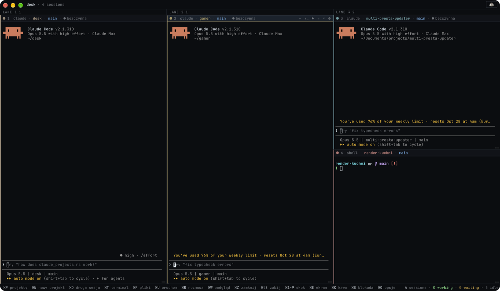
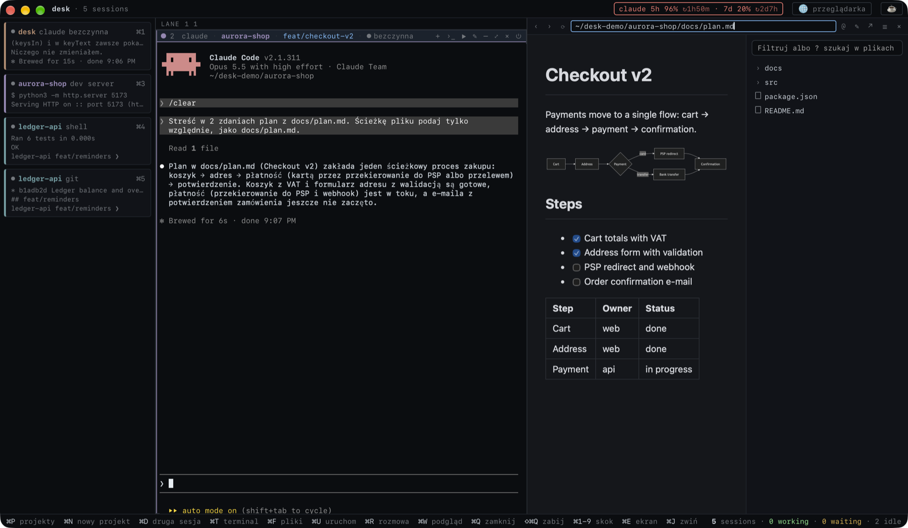
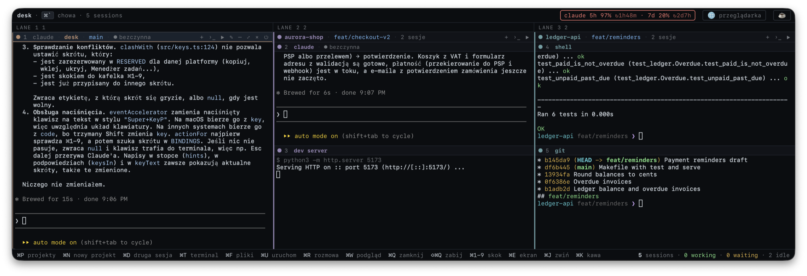
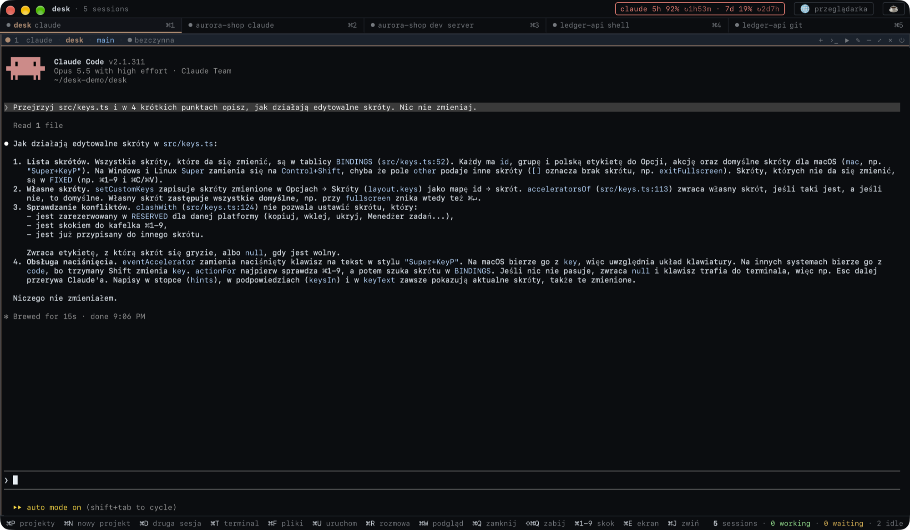
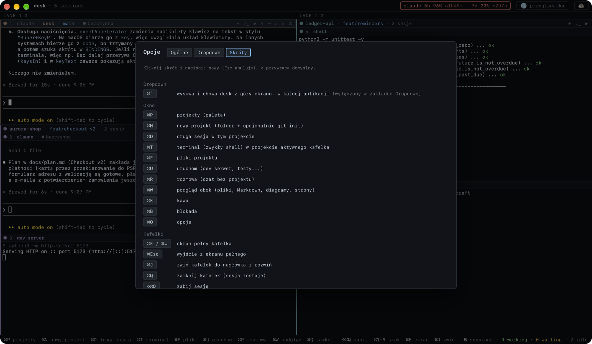
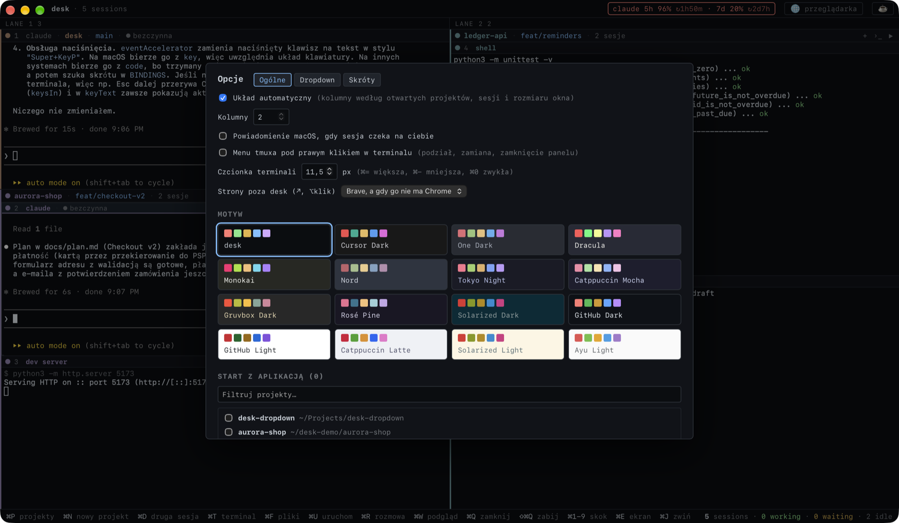
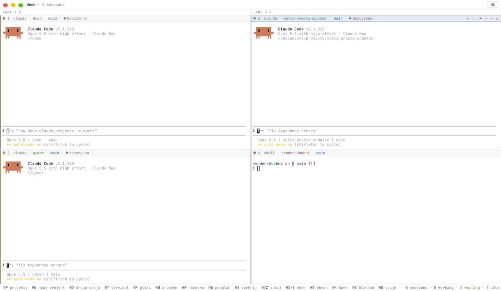

<div align="center">

# desk

**Jedno okno. Wszystkie sesje agentów. Każdy projekt na swoim miejscu.**

Natywna aplikacja z siatką żywych terminali: po jednej sesji Claude Code
(albo Codex, opencode, Gemini, aider, shell) na projekt.


[Funkcje](#funkcje) · [Skróty](#skróty) · [Instalacja](#instalacja) · [Rozwój](#rozwój)

</div>

<br>



<br>

<table>
<tr>
<td width="33%" valign="top">

**Sesje przeżywają okno**

Każda sesja żyje w tmux na prywatnym sockecie. Zamykasz desk, otwierasz znowu: kafelki wracają w tym samym układzie. Po restarcie komputera też, a Claude wraca do swojej ostatniej rozmowy.

</td>
<td width="33%" valign="top">

**Stan widać od razu**

Hooki Claude Code mówią, kto pracuje, kto czeka, a kto jest bezczynny. Dołączane przez `claude --settings`, więc Twoja konfiguracja zostaje nietknięta.

</td>
<td width="33%" valign="top">

**Zero tokenów**

Okno nie wywołuje żadnych modeli. Limity planu czyta z plików, które agenci i tak zapisują lokalnie.

</td>
</tr>
</table>

---

## Funkcje

### Podgląd obok sesji



⌘W otwiera panel obok terminali. Kliknięty link (strona, `localhost`, plik) otwiera się w nim, a ⌥-klik
w przeglądarce. W Opcjach (Terminal i linki) można to odwrócić albo wyłączyć zwykły klik: wtedy link
otwiera dopiero ⌘-klik (panel) lub ⌥-klik (przeglądarka). Klikalne są też ścieżki względne, np. `docs/plan.md`, liczone od folderu projektu kafelka.

- **Pokazuje** strony, obrazki, PDF, Markdown z diagramami mermaid, pliki `.mmd`, JSON, CSV i TSV jako
  tabelę oraz kod i tekst.
- **Edytuje** kod i tekst od razu, z kolorowaniem składni w kolorach motywu. Markdown, diagramy
  i tabele startują jako podgląd, a ✎ przełącza je na edytor. ⌘S zapisuje, ⌘Z / ⌘⇧Z cofa i ponawia.
- **Pasek adresu** działa jak w przeglądarce: wstecz, odśwież, wpisany adres albo ścieżka. 🌐
  u góry otwiera panel od razu z paskiem.
- **Strony poza desk:** ↗ otwiera stronę w Brave, a gdy go nie ma w Chrome (do zmiany w Opcjach,
  także na przeglądarkę systemową), a plik w jego domyślnym programie. Panel nie ma rozszerzeń, więc
  przy polu hasła pasek proponuje „🔑 Zaloguj w Brave (Bitwarden)”.
- **Reszta sesji** czeka po lewej jako mini karty ze stanem i ostatnimi liniami. Klik albo ⌘1–9
  przenosi sesję do środka.

### Dropdown z góry ekranu



⌘` z dowolnej aplikacji: desk zjeżdża z góry ekranu, na którym jest kursor, jak okno iTerm na skrót.
Na całą szerokość, nad innymi oknami i na każdym biurku. Pasek menu zostaje od aplikacji, w której
pracujesz, a desk znika wtedy z Docka i ⌘Tab. Drugie ⌘` chowa go i wraca do poprzedniej aplikacji;
klik w inną aplikację też go chowa. Przeciągnięta dolna krawędź ustawia wysokość na stałe.

Opcje → Dropdown: wysokość, czas animacji, chowanie przy utracie fokusu i wyłączenie (przywraca zwykłe
okno). Na Windows i Linuksie skrót to Ctrl+`, włączany w Opcjach.

### Pełny ekran z zakładkami



⌘E (albo ⌘↵) daje kafelkowi całe okno, a ⌘Esc wraca do siatki. Nad nim pasek zakładek: kropka stanu,
projekt, rodzaj sesji i skrót. Klik w zakładkę przełącza sesję, a zamknięcie kafelka zostawia pełny
ekran na sąsiednim.

### Skróty pod Ciebie



Każdy skrót desk zmienisz w Opcje → Skróty: kliknij skrót i naciśnij nowy, ↺ wraca do domyślnego.
Zajęty skrót (inna akcja, ⌘C / ⌘V, ⌘Z...) desk odrzuca z komunikatem, a nowe skróty od razu widać
w dolnym pasku i podpowiedziach.

### Motywy

<table>
<tr>
<td width="50%"></td>
<td width="50%"></td>
</tr>
</table>

16 motywów, ciemnych i jasnych: desk, Cursor Dark, One Dark, Dracula, Monokai, Nord, Tokyo Night,
Catppuccin (Mocha, Latte), Gruvbox, Rosé Pine, Solarized (Dark, Light), GitHub (Dark, Light), Ayu Light.
Zmieniają okno i terminale od razu.

### Wszystko inne

| | |
|---|---|
| **Projekty** | Sam znajduje repo git i projekty z `~/.claude/projects`. Worktree są pod repo głównym, a ręcznie dodasz dowolny folder. |
| **Nowy projekt** | ⌘N tworzy folder (opcjonalnie `git init`) i od razu otwiera w nim sesję. |
| **Autostart** | W Opcjach wybierasz projekty, które startują z desk. Domyślnie żaden. |
| **Agenci** | Claude Code, Codex, opencode, Gemini, aider, shell, a w Opcjach także własne komendy. Tab w palecie przełącza agenta. |
| **Druga sesja** | Kilka sesji w jednym projekcie (⌘D), w jednej ramce projektu: pod sobą, obok siebie albo w zakładkach (ikony w nagłówku ramki). ⌘T dokłada do niej zwykły terminal. |
| **Rozmowa** | ⌘R: czat o czymkolwiek, bez projektu, każdy we własnej ramce i czystym folderze. Zachowanie ustawiasz w `rozmowa/CLAUDE.md` w danych desk. |
| **Ostatnie rozmowy** | ⌘S: rozmowy Claude z projektu aktywnego kafelka, od najnowszej, z tytułem i branchem. Wybrana wraca w nowym kafelku (`claude --resume`), a otwarta tylko dostaje fokus. |
| **Zapisane rozmowy** | Nazwa kafelka z Claude (✎) zapisuje jego rozmowę. W ⌘S zapisane stoją na górze, zawsze wszystkie, pod Twoją nazwą, a wybrana wraca z tą nazwą także po zamknięciu kafelka i restarcie. ⌘↵ albo ✎ w ⌘S nazywa rozmowę, ⌘⌫ albo × usuwa ją z zapisanych. Po `/clear` nazwa zostaje przy starej rozmowie. |
| **Sesje w tle** | ⌘Q zamyka kafelek, a sesja działa dalej. Gdy takie są, górny pasek pokazuje „N w tle”, a ⌘Y (albo klik w licznik) otwiera ich listę: ↵ otwiera sesję w kafelku, ⌘⌫ albo ✕ ją zabija, „Zabij wszystkie” kończy resztę. Przy zamykaniu desk (⏻) widać, które sesje zostaną, i można zabić wszystkie naraz. |
| **Limity** | Górny pasek: zużycie planu (5h / 7d) dla otwartych agentów, z czasem do resetu (↻2h13m). Claude z konta co 5 min i ze status line sesji, Codex z `~/.codex/sessions`. Kolor z najgorszego limitu: ocena Anthropic, a bez niej bursztyn od 70% i czerwień od 90%; kropka, gdy ostrzega coś, czego licznik nie pokazuje (limit modelu, np. Fable, albo tempo). |
| **Szczegóły limitów** | Klik w licznik otwiera dymek (zakładki albo wszystko naraz, Opcje → Statystyki AI). **Teraz**: tempo i prognoza, czy limit skończy się przed resetem, dzienny budżet tygodnia, limity modeli i resety do `/limit-reset`. **Sesje**: model, koszt (cennik API, nie rachunek), cache i szacowany udział każdej sesji w oknie 5 h, liczony z kosztu sesji desk albo z transkryptów Claude Code. **Historia**: ostatnie 24 h i tydzień dzień po dniu; desk trzyma ją 8 dni w `usage-history.jsonl` w swoich danych. |
| **Układ** | Ramki stoją tam, gdzie je przeciągniesz (przy brzegu kolumny powstaje nowa), a linie między kolumnami, ramkami i sesjami zmieniają rozmiar. Nowy projekt trafia w wolne miejsce, a ⌘L układa wszystko od nowa. W Opcjach wyłączysz dokładanie kolumn i ustawisz ich liczbę ręcznie. |
| **Okno** | Otwiera się tam, gdzie je zamknięto: ten sam monitor, miejsce i rozmiar. Gdy monitora nie ma, okno otwiera się domyślnie. |
| **Kafelek** | Projekt w swoim stonowanym kolorze, branch git (klik przełącza przez `git switch`, który przy niezapisanych zmianach odmawia) i stan. Powiadomienie, gdy sesja czeka, a okno nie ma fokusu. |
| **Prawy klik** | Trafia do programu, który obsługuje mysz (vim, htop). Menu tmuxa (podział, zamiana, zamknięcie panelu) włączysz w Opcje → Ogólne. |
| **Kopiuj i wklej** | Zaznaczenie trafia do schowka (także z tmux). ⌘C / ⌘V, a na Windows i Linuksie Ctrl⇧C / Ctrl⇧V. Program zmieni schowek tylko do 3 s po Twoim kliknięciu albo klawiszu w kafelku (np. `/copy` w Claude), każda zmiana pokazuje komunikat, a czytać schowka nie może. |
| **Czcionka** | ⌘= większa, ⌘- mniejsza, ⌘0 zwykła. Rozmiar w px ustawisz też w Opcjach. |
| **Pliki** | ⌘F: drzewo plików projektu (z `git ls-files`, bez `node_modules`). Filtr po nazwie, `?tekst` szuka w treści. Klik pokazuje plik w podglądzie, dwuklik otwiera edytor. Folder ma akcje: dodaj do sesji (`@ścieżka`), terminal tutaj, pokaż w Finderze. |
| **Uruchom** | ⌘U albo ▶: skrypty z `package.json` (pnpm/yarn/npm/bun według lockfile), `cargo run`/`test`, cele `Makefile`, `docker compose up`, Django. Link `localhost` z wyjścia otwiera podgląd. |
| **Kawa** | ⌘K: komputer nie zaśnie. Drugie ⌘K: także przy zamkniętej klapce. Wyłącza się sama przy przegrzaniu albo baterii ≤15%. Działa na macOS, Windows i Linuksie. |
| **Temperatura** | Górny pasek: temperatura procesora (żółta 10°C przed progiem, czerwona od progu). Co desk robi przy przegrzaniu, wybierasz w Opcje → Zasilanie: nic, zwalnia sesje (domyślnie), wiatraki, potem zwalnianie (wiatraki od własnego, niższego progu), wiatraki i zwalnianie albo tylko wiatraki. **Zwalnianie:** gdy przez 15 s temperatura trzyma się powyżej progu (domyślnie 75°C), desk zwalnia pracę w swoich sesjach: testy, buildy i wszystko, co uruchamia agent, działają dalej, tylko wolniej (↓ przy temperaturze). Tego, w czym piszesz (powłoka, agent, edytor), nie zwalnia, więc pisanie się nie zacina. Innych programów nie rusza. Działa na macOS, Windows i Linuksie. **Wiatraki** (macOS na Apple Silicon): wszystkie idą na pełne obroty (≋ przy temperaturze), ale tylko w trybie, który sam wybierzesz; za pierwszym razem macOS raz pyta o hasło administratora. Wiatraków, którymi steruje inny program (Stats, Macs Fan Control), desk nie rusza. Pełna moc sesji i auto wiatraków wracają 7°C niżej. |
| **Język** | Polski albo angielski. Pierwsze uruchomienie bierze język systemu (polski, a każdy inny to angielski), zmienisz go w Opcje → Ogólne. |
| **Blokada** | ⌘B: terminale widać, ale nic nie wpiszesz, dopóki nie odblokujesz: Touch ID albo hasło na macOS, Windows Hello na Windows, hasło konta na Linuksie. |

---

## Skróty

| Okno | | Kafelki | |
|---|---|---|---|
| ⌘P | projekty (paleta) | ⌘1–9 | skok do kafelka |
| ⌘N | nowy projekt | ⌘E / ⌘↵ | ekran pełny, ⌘Esc wraca |
| ⌘D | druga sesja w projekcie | ⌘J | zwiń do nagłówka z ostatnią linią (⌘J albo klik rozwija) |
| ⌘T | terminal w projekcie kafelka | ⌘Q | zamknij kafelek (sesja zostaje) |
| ⌘F | pliki projektu | ⌘⇧Q | zabij sesję |
| ⌘U | uruchom (dev serwer, testy...) | ✎ | nazwij kafelek (albo prawy klik na tytule), pusta nazwa wraca do domyślnej |
| ⌘R | rozmowa | ⌘L | ułóż ramki od nowa |
| ⌘S | zapisane i ostatnie rozmowy Claude w projekcie | ⌘⇧T | przywróć zamknięty kafelek |
| ⌘Y | sesje w tle (bez kafelka) | | |
| ⌘W | podgląd obok | **Terminal** | |
| ⌘K | kawa | ⌘= / ⌘- / ⌘0 | czcionka większa / mniejsza / zwykła |
| ⌘B | blokada | ⌘C / ⌘V | kopiuj zaznaczenie / wklej |
| ⌘` | dropdown z góry ekranu | | |
| ⌘O | opcje | | |
| ⏻ | zamknij desk z dropdownu (z potwierdzeniem; skrót przypiszesz w Opcjach) | | |

W palecie: ↵ otwiera, ⌘↵ włącza lub wyłącza autostart, ⌘⌫ zabija sesję, Tab wybiera agenta.
Zwykłe Esc trafia do terminala, więc dalej przerywa Claude. desk zamyka się z menu (desk › Quit desk), a w dropdownie przyciskiem ⏻ na górnym pasku.
⌘⇧Q desk przejmuje, zanim zrobi to macOS, więc skrót nie wylogowuje z systemu.

Wszystkie poza ⌘1–9, kopiuj / wklej, klawiszami palety i ⌘S w edytorze zmienisz w Opcje → Skróty.
Na Windows i Linuksie ⌘ to Ctrl⇧ (Ctrl⇧P, Ctrl⇧D...), a zabicie sesji to Ctrl⇧⌫.

---

## Instalacja

Gotowe paczki są w [Releases](https://github.com/knehrybecki/desk/releases):

| System | Paczka |
|---|---|
| macOS (Apple Silicon, M1 i nowsze) | `.dmg` |
| Linux | `.deb`, `.AppImage` |
| Windows 10/11 | `*-setup.exe` |

Aplikacja nie jest podpisana, więc na macOS po skopiowaniu do Applications uruchom raz:

```bash
xattr -dr com.apple.quarantine /Applications/desk.app
```

### Wymagania

- macOS, Linux (webkit2gtk 4.1) albo Windows 10/11 (WebView2).
- **tmux przychodzi z desk:** jest w aplikacji na macOS i w AppImage, a paczka `.deb` instaluje go
  z repozytorium systemu. Twój własny `tmux` (3.2+) w PATH ma pierwszeństwo. Bez żadnego sesje kończą
  się razem z desk (jak na Windows), a okno o tym mówi.
- **Agentów nie instalujesz ręcznie.** Pierwszy kafelek z brakującym agentem uruchamia jego oficjalny
  instalator (Claude Code, Cursor, opencode i aider przez `curl`, Codex i Gemini przez `npm`, więc
  potrzebny jest Node.js), a potem samego agenta. W palecie taki agent ma znak ↓. desk bierze PATH
  z Twojej powłoki logowania, a do tego `~/.local/bin` i `~/.opencode/bin`.

### Aktualizacje

desk raz dziennie sprawdza, czy w Releases jest nowsza wersja (Opcje → Aktualizacje → „Sprawdź teraz”
sprawdza od razu). Repozytorium jest prywatne, więc pyta przez GitHub CLI (`gh`, zalogowane kontem
z dostępem); bez `gh` po prostu nie ma powiadomień. Nowa wersja pojawia się u góry jako `↑ 0.1.x`,
a kliknięcie pobiera ją, podmienia aplikację i uruchamia ponownie:

- macOS: podmienia `desk.app` tam, gdzie leży; sesje w tmux działają dalej,
- Windows: uruchamia nowy instalator; sesje w oknie desk się kończą,
- Linux: podmienia plik `.AppImage`; przy instalacji z `.deb` otwiera stronę wydania.

<details>
<summary><b>Windows</b></summary>

- **Sesje działają bez tmux:** trzyma je sam desk (ConPTY), więc kończą się po zamknięciu desk.
  Zamknięcie kafelka (Ctrl⇧Q) zostawia sesję, dopóki desk jest otwarty.
- **Skróty to Ctrl+Shift+litera** zamiast ⌘. Zwykłe Ctrl+C trafia do programu w terminalu,
  a kopiowanie i wklejanie to Ctrl⇧C / Ctrl⇧V. Tak samo jest na Linuksie.
- **Agenci działają w PowerShellu** (pwsh, jeśli jest zainstalowany) i po wyjściu z agenta zostaje
  PowerShell.
- **Hooki i status line uruchamiają sam `desk.exe`**, więc nie potrzeba sh. Limity Claude działają,
  a status line z `~/.claude/settings.json` wywołuje się przez Git Bash albo PowerShell, tak jak robi
  to Claude Code.
- **Kawa** trzyma komputer obudzonym. Tryb z klapką ustawia w planie zasilania „po zamknięciu
  pokrywy: nic nie rób” (`powercfg`, bez uprawnień administratora). Poprzednie ustawienie wraca po
  wyłączeniu kawy, a także wtedy, gdy desk się zamknie albo padnie.
- **Blokada** odblokowuje się przez Windows Hello (PIN, odcisk palca albo twarz). Bez Windows Hello
  ustaw PIN w Ustawienia → Konta → Opcje logowania.

</details>

<details>
<summary><b>Bezpieczeństwo i prywatność</b></summary>

- **Kawa z klapką (macOS)** używa `pmset -a disablesleep`. Za pierwszym razem macOS pyta o hasło
  administratora i desk zapisuje regułę `/etc/sudoers.d/desk-pmset`, która pozwala tylko na
  `pmset -a disablesleep 1` i `0`. Później nie pyta. Regułę usuwasz w Opcje → Kawa. Jeśli desk zginie
  w trakcie, osobny strażnik przywraca usypianie.
- **Kawa na Linuksie** używa `systemd-inhibit` (z klapką: `handle-lid-switch`), a przegrzanie
  i baterię czyta z `/sys`.
- **Wiatraki (macOS)** zapisuje mały program `desk-fans` z paczki desk, bo SMC przyjmuje zapis tylko od
  roota. Gdy sam wybierzesz tryb z wiatrakami, macOS raz pyta o hasło administratora, a desk instaluje
  go jako `/Library/PrivilegedHelperTools/pl.makarowski.desk.fans` (właściciel root, po sprawdzeniu
  sumy SHA-256 kopii) z regułą `/etc/sudoers.d/desk-fans`, która pozwala tylko na `max` i `auto`.
  Żadnej innej wartości ani klucza SMC nie da się nim zapisać. Odczyt wiatraków nie wymaga uprawnień.
  Zgodę usuwasz w Opcje → Zasilanie. Gdy desk się zamknie albo zginie, osobny strażnik przywraca auto.
- **Temperatura** na macOS pochodzi z czujników procesora przez IOKit (jak w Stats czy macmon, bez
  uprawnień administratora), a zwalnianie to `setpriority(PRIO_DARWIN_BG)`, czyli to samo co
  `taskpolicy -b`. Na Windows desk czyta licznik „Thermal Zone Information” i włącza EcoQoS (tryb
  efektywności z Menedżera zadań). Na Linuksie czyta `/sys` (hwmon, strefy termiczne) i przenosi
  procesy sesji do zakresu systemd użytkownika `desk-sessions.scope` z limitem CPU na połowę rdzeni
  (`busctl --user`). Zwalnia tylko procesy uruchomione w sesjach desk, a przy zamknięciu desk
  przywraca im pełną moc. Pełną moc zawsze mają powłoki sesji i program, który powłoka uruchomiła,
  dopóki jego terminal przyjmuje pojedyncze klawisze (agent, edytor); zwalniane jest to, co taki
  program uruchamia. Program uruchomiony z powłoki bez trybu pojedynczych klawiszy (`pnpm test`)
  jest zwalniany w całości. Na Windows desk nie zna trybu konsoli, więc program uruchomiony
  z powłoki zawsze ma pełną moc.
- **Blokada** chroni sesje desk, a nie cały komputer: inny program działający jako Ty nadal może
  podłączyć się do `tmux -L desk`. Cały komputer blokuj ekranem blokady systemu. Na Linuksie hasło
  konta sprawdza PAM (tak jak wygaszacze ekranu).
- **Limity Claude** desk co 5 minut pobiera sam z Anthropic (to samo zapytanie co `/usage` w Claude
  Code, bez modelu i bez tokenów), używając loginu Claude Code: na macOS z pęku kluczy
  (`Claude Code-credentials`), gdzie indziej z `~/.claude/.credentials.json`. Token idzie tylko do
  `api.anthropic.com`; desk go nie odświeża ani nie zapisuje. Do tego dochodzą odczyty ze status line
  sesji desk (świeże po każdej turze), a wygrywa najświeższy. Bez loginu zostają same sesje. Twoja
  własna status line działa dalej: desk ją wywołuje.
- **Udział sesji z transkryptów** (Opcje → Statystyki AI) desk liczy lokalnie: czyta tokeny
  z `~/.claude/projects` i wycenia je według cennika API z 14.11.2026. Treści rozmów nie zapisuje
  ani nigdzie nie wysyła.
- **Podgląd lokalnych plików** widzi tylko folder podglądanego pliku i nie ma dostępu do API desk.
  Markdown i inne dokumenty desk renderuje sam: ich własne skrypty się nie uruchamiają (mermaid jest
  wbudowany, działa bez internetu).

</details>

---

## Rozwój

```bash
pnpm install
pnpm tauri dev          # uruchomienie w trybie deweloperskim
pnpm check              # tsc, eslint, vitest, clippy, cargo test
pnpm tauri build        # macOS: src-tauri/target/release/bundle/macos/desk.app
```

Dane: `~/Library/Application Support/desk/` (macOS) albo `~/.local/share/desk/` (Linux): `layout.json`,
`state/`, ustawienia hooków, skrypty `desk-hook.sh` / `desk-statusline.sh` i `tmux.conf`. Hooki opisuje
[docs/hooks.md](docs/hooks.md). `DESK_SUPPORT_DIR` wskazuje inny folder danych, np. dla drugiej,
testowej instancji.

Napisy interfejsu są w `src/locales/` (`pl.ts` wyznacza klucze, `en.ts` musi mieć wszystkie), komunikaty
z Rusta w makrze `tr!` (`src-tauri/src/i18n.rs`). Nowy język: kolejny plik w `src/locales/` i wpis w
`LANGUAGES` w `src/i18n.ts`.

Release: push tagu `v*` uruchamia `.github/workflows/release.yml`, który buduje wersje na macOS
(Apple Silicon, `.app` + `.dmg`), Linux (`.deb` + `.AppImage`) i Windows (`setup.exe`) i dołącza je
do szkicu release na GitHubie.
