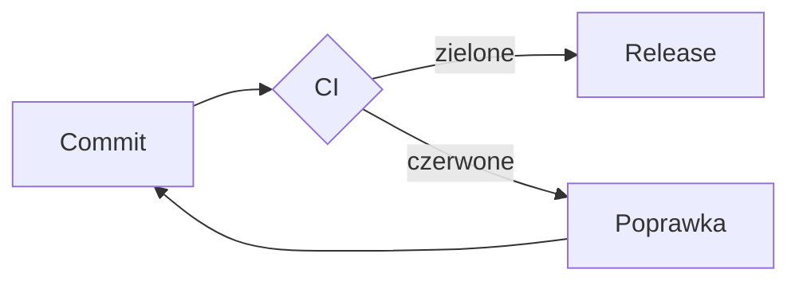

# Plan wdrożenia

Tekst z **pogrubieniem**, `kodem` i [linkiem](https://example.com).

| Platforma | Paczka |
|---|---|
| macOS | .dmg |
| Linux | .deb, .AppImage |
| Windows | setup.exe |

- [x] testy
- [ ] podpis
